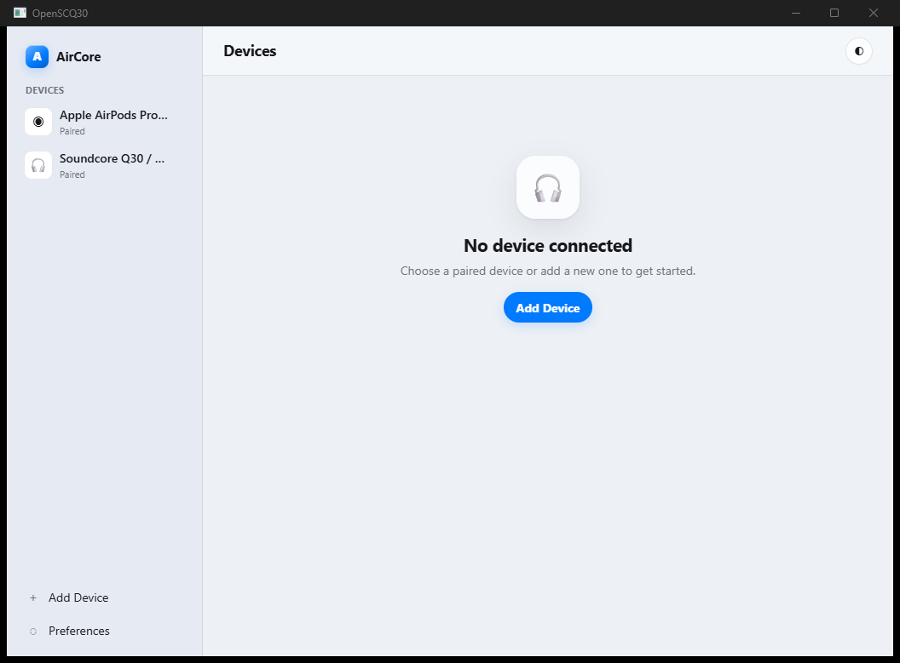

# AirCore

**AirCore** is a unified desktop audio control center designed around a clean, Apple HIG-inspired interface — built to seamlessly manage both **Apple AirPods Pro 2** and **Soundcore Life Q30** (alongside the full Soundcore lineup) from a single native Rust application.



---

## Highlights

- **Dual-Ecosystem Support (`Air` + `Core`)**
  - **Apple AirPods Pro 2**: Noise Control (*Off*, *Noise Cancellation*, *Transparency*, *Adaptive*), Adaptive Audio Strength, Conversation Awareness, Personalized Volume, Ear Detection, Stem Controls, Hearing Assistance, and per-piece battery telemetry (*Left / Right / Case*) via the `WPods` AAP named-pipe bridge on Windows (`\\.\pipe\WPods.Aap`).
  - **Soundcore Life Q30** *(+ 30+ Soundcore headphones & earbuds)*: Multi-scene ANC (*Transport / Indoor / Outdoor*), Transparency, Custom Profiles, Quick Presets, and full 8-band parametric/graphic EQ.
- **Apple-Inspired Desktop UI**
  - Refined `libcosmic` interface with tone-stepped Light & Dark surfaces, `1px` hairline borders, inset-grouped cards, responsive split navigation, and interactive frequency-response EQ curves (*Hero* & *Thumbnail* previews).
  - Streamlined device picker focused by default on **Soundcore Life Q30** and **Apple AirPods Pro 2**, with a one-click toggle to reveal all supported models.
- **35 Selectable EQ Presets**
  - Preserves all 22 classic Soundcore presets intact and adds 13 genre-tuned curves: **Trap**, **Techno**, **Hard Techno**, **House**, **Drum & Bass**, **Dubstep**, **Metal**, **Lo-Fi**, **Indie**, **Reggae**, **Ambient**, **Funk**, and **Country** (alongside **Hip Hop**, **Rock**, **Electronic**, and more).

---

## Running Locally

```powershell
# Launch AirCore GUI
cargo run --release -p openscq30-gui

# Launch in Demo Mode (test both Life Q30 & AirPods Pro 2 without Bluetooth hardware)
cargo run -p openscq30-gui -- --demo-mode

# CLI usage
cargo run -p openscq30-cli -- --help
```

> **Note for Apple AirPods Pro 2 on Windows:** Real-hardware AAP control connects through `\\.\pipe\WPods.Aap` from [FPNDev/wpods](https://github.com/FPNDev/wpods) (`WPods.Service`).

---

## Credits & License

- Forked from [Oppzippy/OpenSCQ30](https://github.com/Oppzippy/OpenSCQ30)
- Apple AirPods Pro 2 AAP Windows integration based on [FPNDev/wpods](https://github.com/FPNDev/wpods)
- Licensed under **GPL-3.0-or-later** ([LICENSE.txt](LICENSE.txt))
